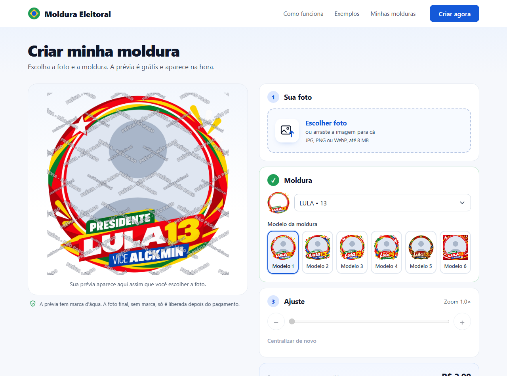
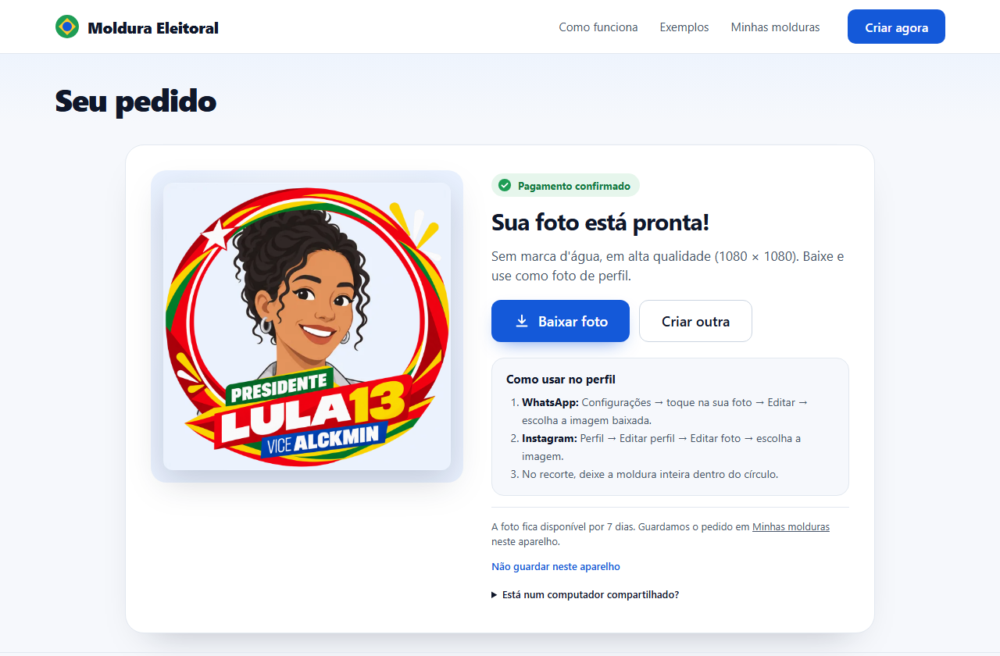
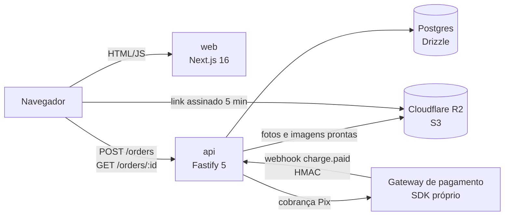
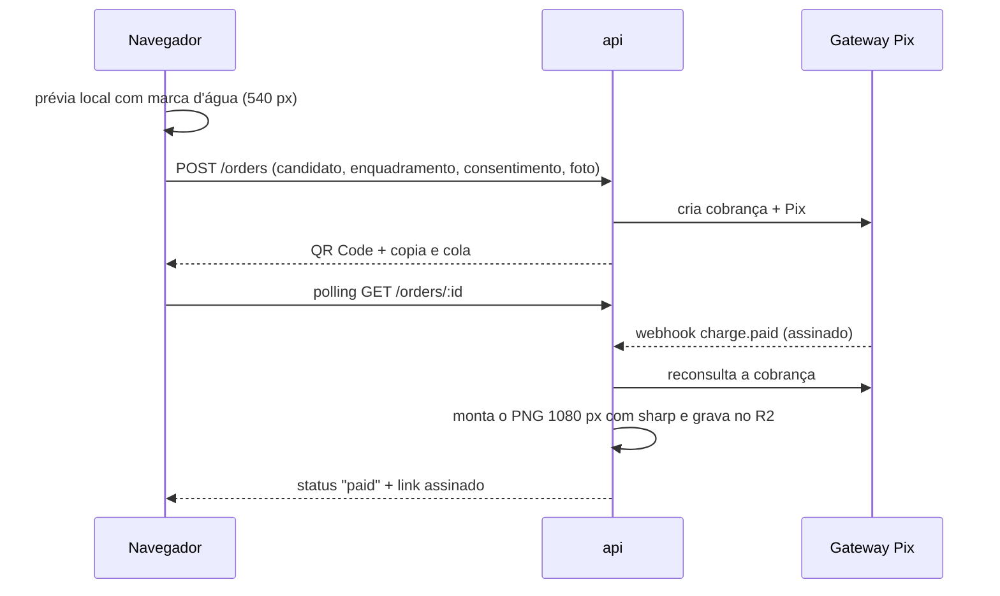

# Moldura Eleitoral

Site para colocar na foto de perfil a moldura do candidato que você apoia. Você envia a foto, ajusta o enquadramento, vê a prévia na hora (grátis, com marca d'água), paga **R$ 2,99 por Pix** e baixa o PNG de 1080 × 1080 sem marca d'água, montado no servidor só depois de o pagamento ser confirmado.

> **Projeto encerrado.** Ficou no ar em `molduraeleitoral.com` durante o 2º turno das eleições de 2026 (outubro de 2026), com vendas reais por Pix. Depois da eleição o site foi desligado e os arquivos dos clientes foram apagados. O código ficou aberto como portfólio.

| Página inicial | Editor com prévia | Pedido pago |
| --- | --- | --- |
|  |  |  |

As ilustrações das pessoas são fictícias, geradas por IA e marcadas no site com o selo "IA".

## O que tem de interessante aqui

- **Pagamento por Pix ponta a ponta.** A api cria a cobrança, gera o QR Code localmente a partir do "copia e cola" e libera o pedido por dois caminhos independentes: o webhook do provedor e o polling da tela do pedido. O webhook é assinado em HMAC (padrão Standard Webhooks) com janela de 5 minutos e é idempotente pelo id do evento. Mesmo com assinatura válida, a api reconsulta a cobrança antes de liberar. Se ainda não estiver paga, responde 503 para o provedor tentar de novo.
- **A imagem limpa nunca sai antes do pagamento.** O navegador só recebe uma prévia de 540 px com marca d'água em duas grades cruzadas. Um teste garante que todo recorte de 15% × 15% contém marca. A foto final é montada no servidor com `sharp` (máscara alfa e posição do furo de cada moldura) e baixada por um link assinado do R2 que vale 5 minutos.
- **Privacidade by design (LGPD).** Como a moldura revela preferência política, que é dado sensível, o fluxo funciona assim:
  - Há consentimento explícito antes do envio.
  - Nenhum nome, CPF ou e-mail é pedido.
  - O IP fica só em memória, para limitar requisições.
  - Os logs não carregam o id do pedido, só um hash curto.
  - Fotos e pedidos são apagados sozinhos: não pagos em 24 h, pagos em 7 dias. Uma regra de ciclo de vida no bucket serve de rede de segurança.
  - O provedor de pagamento nunca recebe a foto nem o candidato.
- **Operação pensada para a lei eleitoral.** Um "blackout" de vendas configurável fecha o checkout sozinho no dia da votação. Uma chave liga e desliga as vendas sem deploy.
- **Molduras de formato livre.** Cada arte tem uma máscara e a medida do "furo". Um script importa uma arte nova, gera a máscara e mede o furo. Um teste confere todas as combinações de candidato × modelo.
- **Segurança no web:**
  - Cabeçalhos: CSP restrito, `Referrer-Policy: no-referrer`, `X-Frame-Options: DENY`, HSTS.
  - Na api: CORS por lista, limite de requisições por IP com `TRUST_PROXY` calculado pela cadeia Cloudflare → Traefik.
  - Tipo de arquivo validado pelos bytes iniciais antes do processamento.
- **~280 testes automatizados** (api, common e web) com `node:test`. Os testes da api rodam contra um Postgres real, com o gateway de pagamento e o storage em memória.

## Arquitetura





## Stack

| Parte | Tecnologias |
| --- | --- |
| `web` | Next.js 16 (App Router), React 19, CSS puro (sem framework de UI ou biblioteca de animação), Canvas para a prévia |
| `api` | Node 22+, Fastify 5, Drizzle ORM + Postgres, `sharp`, MinIO SDK (compatível com R2/S3), Zod 4, Pino |
| `common` | Schemas Zod, candidatos, partidos, preço e geometria das molduras, compartilhados entre api e web |
| Infra | Docker, Coolify (self-hosted), Cloudflare (DNS, proxy, R2) |
| Testes | `node:test` + `tsx`, Postgres em Docker |

## Estrutura

```
common/   schemas, candidatos, partidos, preço, furos das molduras
api/
  src/core/                 env, banco, storage, logger, proxy, blackout
  src/modules/orders/       criar pedido, montar imagem, sincronizar, limpeza
  src/modules/payments/     gateway Pix e webhook
  src/scripts/              setup do banco, importação de molduras, webhook
  assets/frames/            molduras 1080 px + máscaras
  drizzle/                  migrações
web/
  src/app/                  home, /criar, /pedido/[id], /minhas, /privacidade, /termos
  src/lib/                  marca d'água, geometria da prévia, polling, "Minhas molduras"
docs/
  operacao.md               manual de operação completo da época em produção
  superpowers/              especificação e plano de implementação originais
```

## Rodar localmente

Pré-requisitos: Node 22.9+, pnpm 11 e Docker.

```bash
docker compose up -d          # Postgres :5440 e MinIO :9300, só em 127.0.0.1
pnpm install
cp api/.env.example api/.env  # preencha as variáveis (veja abaixo)
cp web/.env.example web/.env.local
pnpm --filter @moldura/api db:setup
pnpm dev:api                  # http://localhost:6600
pnpm dev:web                  # http://localhost:6610
```

O pagamento usa o SDK do gateway próprio do autor (`@felipepasc/core-sdk`, no npm). Sem uma chave válida a api não sobe, mas os testes rodam sem ela, com um gateway falso:

```bash
pnpm test        # api + common + web (precisa do Postgres do docker compose)
pnpm typecheck
```

Os detalhes ficam em [`docs/operacao.md`](docs/operacao.md): variáveis de ambiente, deploy, retenção de dados, roteiro de reembolso e checklist de produção.

## Avisos

- Site independente, sem ligação com nenhuma campanha ou partido. As molduras usam só dados públicos: nome de urna, número e cores do partido.
- Os textos de `/privacidade` e `/termos` foram escritos para este projeto e não são aconselhamento jurídico.
